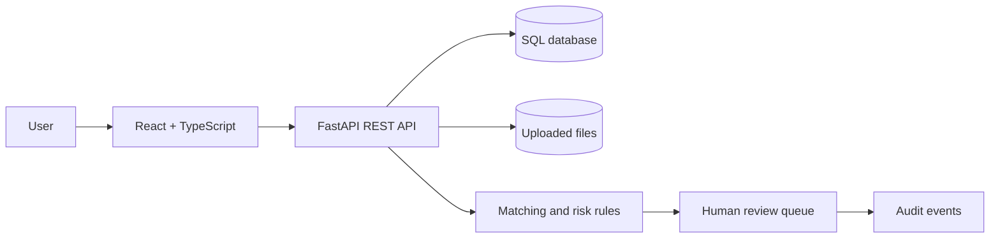

### Autonomous Procurement & Supply Chain Audit Engine

ProcureGuard AI is a full-stack procurement audit application that helps teams inspect procurement records, compare purchase orders with goods-received notes and invoices, identify suspicious patterns, and route exceptions for human review.

> This repository is a runnable MVP foundation. Its matching and risk checks are deterministic, explainable rules—not claims of autonomous financial approval or proven fraud detection. Production deployment requires authentication, authorization, encryption, retention controls, stronger document parsing, and independent validation.

## Features

- Upload procurement documents (PDF, PNG, JPG, JPEG, TXT).
- Store document metadata and extracted text.
- Create and inspect purchase orders, goods-received notes, invoices and vendor contracts.
- Perform PO–GRN–invoice 3-way matching.
- Compare invoice unit prices with contract rates.
- Flag quantity, price, duplicate-invoice and split-invoice risk indicators.
- Route exceptions into a human review queue.
- Record review decisions in an audit trail.
- React + TypeScript dashboard and FastAPI backend.
- SQLite for zero-configuration local development; Docker Compose includes PostgreSQL for containerized use.

## Architecture



## Quick Start

Requirements:

- Python 3.11+
- Node.js 20+
- npm

### Backend

```bash
cd backend

python -m venv .venv

# Windows PowerShell
.venv\Scripts\Activate.ps1

# macOS/Linux
# source .venv/bin/activate

pip install -r requirements.txt
```

Create your environment file from the project root:

```powershell
Copy-Item .env.example backend/.env
```

For the default SQLite setup, start the API:

```bash
uvicorn app.main:app --reload
```

API documentation:

http://localhost:8000/docs

### Frontend

Open another terminal:

```bash
cd frontend

npm install

npm run dev
```

Open:

http://localhost:5173

The frontend expects the API at:

http://localhost:8000

Set `VITE_API_URL` if needed.

## Load Demonstration Records

From the backend directory, with the virtual environment activated:

```bash
python -m scripts.seed_demo
```

Then run an audit using:

```http
POST /api/audits/run
```

The sample invoice intentionally exceeds the received quantity and contracted unit price.

## Docker Compose

From the repository root:

```bash
docker compose up --build
```

Frontend:

http://localhost:5173

API:

http://localhost:8000/docs

The Compose configuration uses PostgreSQL. The default local Python instructions use SQLite.

## Example Workflow

1. Create a vendor.
2. Create a purchase order and goods-received note.
3. Create an invoice referencing that purchase order.
4. Run `POST /api/audits/run`.
5. Review the resulting findings at `GET /api/reviews`.
6. Approve, reject or request changes using `POST /api/reviews/{id}/decision`.

## API Overview

| Method | Endpoint | Purpose |
|---|---|---|
| GET | `/api/health` | Health check |
| GET/POST | `/api/vendors` | List/create vendors |
| GET/POST | `/api/documents` | List/upload documents |
| GET/POST | `/api/records/purchase-orders` | Purchase orders |
| GET/POST | `/api/records/receipts` | Goods-received notes |
| GET/POST | `/api/records/invoices` | Invoices |
| GET/POST | `/api/records/contracts` | Vendor contracts |
| POST | `/api/audits/run` | Run matching and risk checks |
| GET | `/api/audits` | List audit findings |
| GET | `/api/reviews` | Review queue |
| POST | `/api/reviews/{id}/decision` | Record human decision |
| GET | `/api/audit-trail` | Audit event history |
| GET | `/api/dashboard` | Dashboard metrics |

## Data Model and Matching Logic

A purchase order, receipt and invoice are linked by their reference numbers.

The engine compares:

- Ordered quantity.
- Received quantity.
- Invoiced quantity.
- Invoice unit price.
- Contract unit price.

The sample risk rules detect:

- Repeated invoice numbers for the same vendor.
- Multiple invoices from one vendor on the same date whose combined value crosses a configured review threshold.
- Invoice quantity exceeding the received quantity.
- Invoice price exceeding the contract price tolerance.
- Invoice total calculation discrepancies.

These signals are indicators for investigation, not proof of fraud.

## Testing

```bash
cd backend

pytest
```

## Security and Production-Readiness Checklist

- Add identity provider integration and role-based access control.
- Store secrets in a managed secret store; never commit `.env`.
- Use private object storage, malware scanning and file-size/type limits.
- Add tenant isolation, encryption at rest/in transit and retention policies.
- Use PostgreSQL migrations (Alembic), backups and observability.
- Add a durable task queue for OCR/LLM work.
- Add document-level provenance, page coordinates and human verification.
- Evaluate extraction and matching against a labelled test set before operational use.

## Roadmap

1. Layout-aware parsing with Docling and OCR fallback.
2. Background processing with Celery and Redis.
3. LangGraph workflow with extraction, policy and investigation nodes.
4. pgvector retrieval for contract clauses.
5. Neo4j relationship analysis for vendor/account/address networks.
6. PDF.js source highlighting with page and bounding-box provenance.
7. RAG investigation copilot with constrained SQL and citations.
8. Evaluation suite for extraction precision/recall, matching accuracy and reviewer agreement.

## License

MIT — see `LICENSE`.
